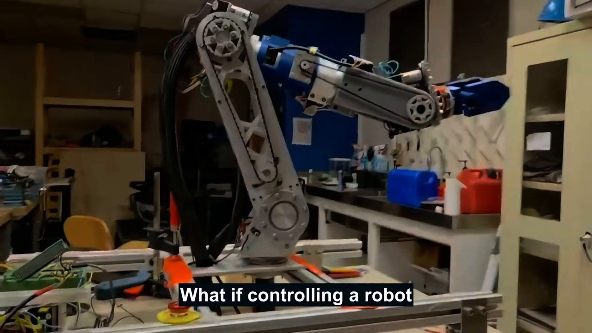
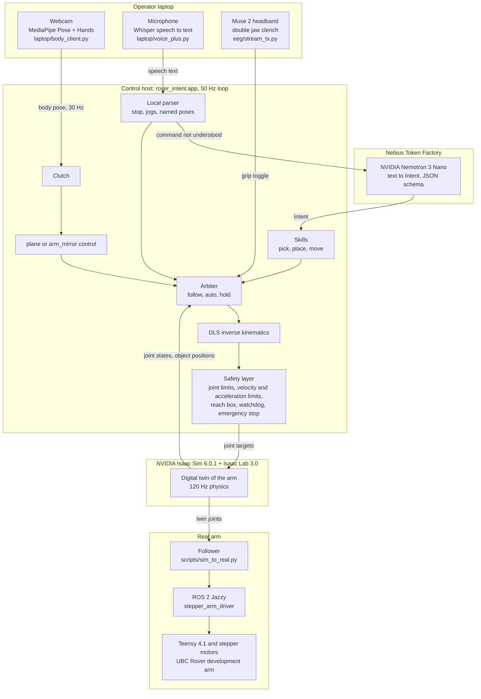
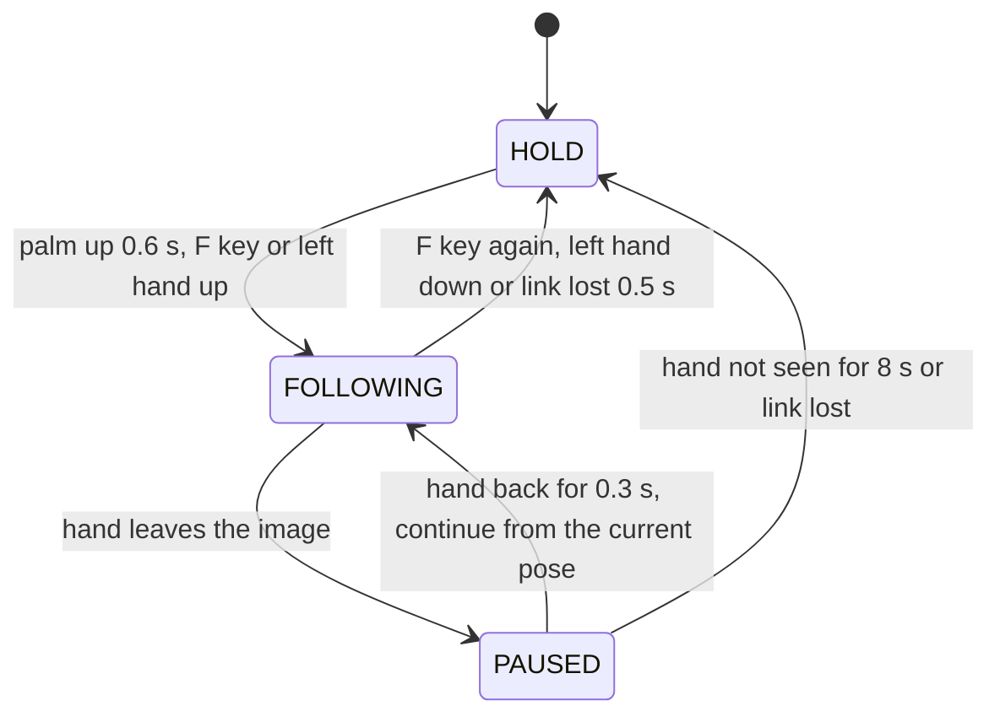

<p align="center">
  <a href="https://youtu.be/N1-LpOunrV4"></a>
  
  
  
  <br>
  
  
  
  
  <a href="LICENSE"></a>
</p>

<p align="center">
  <a href="https://youtu.be/N1-LpOunrV4"></a>
</p>
<p align="center"><sub>Video, 3 minutes. Click the image to open it.</sub></p>

# Argetlam

Argetlam is a control system for a real 6-axis robot arm.
The operator controls the arm with three inputs:

- **Body.** A webcam tracks the right hand. The arm moves with the hand.
- **Voice.** NVIDIA Nemotron on Nebius Token Factory changes speech into robot commands.
- **Muse 2 headband.** Two quick jaw clenches open or close the gripper.

All inputs go through one control loop and one safety layer.
The control loop moves a digital twin of the arm in NVIDIA Isaac Sim.
The real arm follows the joints of the twin.

UBC Rover made Argetlam for the Nebius × NVIDIA Global AI Hackathon, Physical AI track.
The license is [Apache 2.0](LICENSE).
The Python package name is `rover_intent`.

**Video (3 minutes):** https://youtu.be/N1-LpOunrV4

## Purpose

Approximately 1 in 6 people have a significant disability
([WHO](https://www.who.int/news-room/fact-sheets/detail/disability-and-health)).
More than 2.5 billion people need one or more assistive products
([WHO/UNICEF](https://www.who.int/publications/i/item/9789240049451)).
Different people need different ways to control a robot.
Argetlam gives one arm three different inputs:

- An operator who cannot use a controller can move the arm with one hand.
- An operator who cannot use their hands can use voice.
- An operator who cannot speak can use a jaw clench to operate the gripper.

The name comes from Irish myth. King Nuada lost his arm in battle and got a new arm made of silver.

## Results on the real arm

- **Voice pick.** The command "pick up the block" makes the arm pick up the block without help.
  The D415 depth camera finds the block and sends its position to the twin.
  Nemotron changes the command into a pick intent, and the arm plans and does the pick.
  The first success was on 2026-10-28.
  Before that success, many attempts failed. We found the cause of each failure and corrected it
  ([Problems and corrections](#problems-and-corrections-on-the-real-arm)).
- **Body pick.** The operator picked up the same block two times with hand movement only.
- **Voice speed.** Nemotron returned each command in 0.9 to 2.6 seconds.
  Short commands, for example "move left 10 cm" and "stop", do not use the cloud.
  A local parser runs them in less than 50 ms.

---

## Contents
- [Main functions](#main-functions)
- [Try the system without hardware](#try-the-system-without-hardware)
- [Results](#results)
- [Problems and corrections on the real arm](#problems-and-corrections-on-the-real-arm)
- [NVIDIA and Nebius components](#nvidia-and-nebius-components)
- [System architecture](#system-architecture)
- [Inputs](#inputs)
- [Clutch and safety](#clutch-and-safety)
- [Autonomous skills](#autonomous-skills)
- [Hardware](#hardware)
- [Installation and operation](#installation-and-operation)
- [Tests](#tests)
- [Repository layout](#repository-layout)
- [Users](#users)
- [Limitations](#limitations)
- [Next steps](#next-steps)
- [Credits](#credits)

---

## Main functions

| Input | Operator action | Arm action |
|---|---|---|
| Body (webcam) | Hold the right palm up for 0.6 s | The arm starts to follow the right hand |
| Body (webcam) | Move the right hand left, right, up or down | The gripper moves in the same direction |
| Body (webcam) | Point the left thumb up or down | The gripper moves forward or back |
| Body (webcam) | Close or open the right hand | The gripper closes or opens |
| Voice | "move left 10 centimetres", "go to ready", "stow then home" | The local parser runs the command immediately |
| Voice | "pick up the block", "put the cup next to the bottle" | Nemotron makes an intent. The arm plans and does the task |
| Voice | "stop", "hold on", "reset" | The arm stops immediately. These words never go to the cloud |
| Muse 2 | Clench the jaw two times quickly | The gripper opens or closes |

These rules apply to all inputs:

1. Only decisions go to the cloud. Motion, inverse kinematics (IK) and safety stay local.
2. All commands go through the same safety layer.
3. The same code runs with a mock arm, in Isaac Sim and on the real arm.
4. Workspace, home pose, heights and gripper times come from measurements on the real arm.

---

## Try the system without hardware

You do not need a robot, a GPU or an API key for this procedure.
A mock arm replaces the robot.
A script replaces the webcam, the microphone and the headband.
Without `NEBIUS_API_KEY`, an offline parser replaces Nemotron.

1. Install the package:
   ```bash
   uv venv .venv && uv pip install -p .venv/bin/python -e ".[dev]"
   ```
2. Run the tests. This takes approximately 8 minutes with 4 threads:
   ```bash
   .venv/bin/python -m pytest -q
   ```
3. Start the control loop with the mock arm:
   ```bash
   .venv/bin/python -m rover_intent.app --backend mock &
   ```
4. Send a hand circle and two double jaw clenches:
   ```bash
   .venv/bin/python scripts/fake_laptop.py --say "follow me" --circle 6 --toggle-at 2 --toggle-at 4
   ```
   Result: the clutch engages, the arm follows the circle, and the gripper closes and then opens.
5. Send a voice command:
   ```bash
   .venv/bin/python scripts/fake_laptop.py --say "move the cup beside the bottle"
   ```
   Result: the parser makes the intent `move cup beside bottle`. The arm plans a pick and a place.

The app log shows each step, for example `heard ... ->`, `clutch: ...` and `grip toggle ...`.
To use Nemotron, put `NEBIUS_API_KEY` in `.env`.
To replay a recorded session into a running app, use `scripts/replay_session.py`.

---

## Results

All numbers come from logs, test files or bench sessions.
"Real arm" is the physical arm. Other rows show the source: Isaac Sim, synthetic data or offline data.

| Item | Source | Result |
|---|---|---|
| Voice "pick up the block" | Real arm | The arm found the block with the depth camera, went to it and picked it up. First success on 2026-10-28. Each failure before it has a known cause and correction |
| Body pick (webcam) | Real arm | The operator picked up the block 2 times with hand movement only (2026-10-28, recorded session) |
| Tracking of the twin | Real arm | Real joints stay within approximately 0.5° of the twin after they stop. The firmware runs at approximately half the commanded speed, with a command delay of 0.17 to 0.31 s |
| Muse 2 jaw clench | Real headband | 10 of 10 double clenches in a recorded session got to the app. In a replay, 6 of 6 changed the gripper state, with 0 errors |
| Voice delay | Real arm session | Nemotron 3 Nano: 0.9 to 2.6 s for each command. Local parser: less than 50 ms |
| Voice parsing | Test phrases | Nemotron Nano: 7 of 7 correct. Nemotron Super: 5 of 7 correct |
| Gripper with hand and Muse together | Isaac Sim | 530 of 530 commands correct, including 54 conflicts between the two inputs. 0 app errors |
| Autonomous grasp test | Isaac Sim | 9 of 9 correct. All six "move X beside Y" tasks put the object within 1.2 cm |
| Safety layer | Stress test | 20 000 random steps. The velocity and acceleration limits were never exceeded |
| Camera object detection | Synthetic images | ArUco detector: median error 0.05 cm, 90th percentile 0.10 cm, 0 false detections |
| Simulation speed | Isaac Sim | 1.00 × real time with full load |

---

## Problems and corrections on the real arm

The voice pick worked in Isaac Sim before it worked on the real arm.
On 2026-10-28, the voice pick failed many times on the real arm.
The app logs record each attempt.
This table shows each cause in the sequence that we found it:

| Problem | Correction |
|---|---|
| The arm could not get to the pre-grasp pose with the full wrist orientation | Picks keep the wrist orientation, as in body control (`skills.auto_orient: frozen`) |
| The 3 mm alignment tolerance was too small for the stepper motors | Tolerances of 2 cm (waypoint) and 1.5 cm (alignment) on the real arm profile |
| The descent stopped 2.6 cm above the target because the simulated fingers touched the simulated block | A step that stops within 4 cm of its target for 1.5 s counts as complete (`stall_tol`) |
| The arm lifted before the gripper was fully closed | The arm waits 3.2 s after the close command. The gripper needs 2.8 s to close |
| The gripper was rotated, so the fingers touched the edge of the block | The command "grip is level" records the level wrist angle once. Picks then turn the wrist to that angle |

A separate measurement found a height error of 9 cm in the arm model.
The model showed the gripper 16.6 cm above the board. The real gripper was 7.5 cm above the board.
The board height in the configuration now comes from this measurement.
We did not find the cause in the model yet (see [Limitations](#limitations)).

---

## NVIDIA and Nebius components

| Component | Function |
|---|---|
| **NVIDIA Nemotron 3 Nano** (`nvidia/NVIDIA-Nemotron-3-Nano-30B-A3B`) on **Nebius Token Factory** | Changes the speech text into a structured `Intent` with a JSON schema: action, object, spatial relation and reference object. If the request is not clear, it asks a question, for example "which one?" |
| **NVIDIA Isaac Sim 6.0.1 and Isaac Lab 3.0** | The physics twin of the arm. Grasps use friction and finger force, with no attach shortcuts. The scene has the real table heights and a simulated camera. The real arm follows the joints of this twin |
| Nemotron Super (tested) | 5 of 7 correct on the test phrases. Nano was 7 of 7, so Nano is the default |

The system prompt gives the objects in the scene, with a short description of each object.
It also gives one line for each action.
There are no hand-written language rules and no object lists in code.
The model identifies colours, synonyms and unclear requests.
The skill layer refuses objects that the camera or the scene does not show.
The cloud call runs outside the control loop. A "stop" command cancels a cloud call that is not complete.

---

## System architecture



No component sends commands directly to the motors.
Each command moves the twin in Isaac Sim first.
The follower (`scripts/sim_to_real.py`) then sends the joints of the twin to the ROS 2 driver of the real arm.

---

## Inputs

### Body: webcam hand control

The real arm uses `plane` mode ([`docs/PLANE_TELEOP.md`](docs/PLANE_TELEOP.md)).
This mode uses only the image plane of the camera:

- The right hand moves the gripper left, right, up and down.
- The left thumb controls reach. Thumb up moves the gripper forward. Thumb down moves it back.
- A closed hand closes the gripper. An open hand opens the gripper.

Depth is the least accurate MediaPipe axis, so `plane` mode does not use depth.
For this reason, `plane` mode needs no calibration.
Hold the right palm up for 0.6 s. The arm then starts to follow from its current position.

```
 webcam frame → MediaPipe Pose (3-D landmarks in metres) + MediaPipe Hands
   ├─ hand:  the hand whose wrist is on the tracked arm (handedness labels change on mirrored webcams)
   ├─ grip:  fingertip spread / palm size → 0 (closed) … 1 (open); "not found" is never "open"
   └─ gate:  a wrist movement faster than 6 m/s is a tracking error and is ignored
```

`arm_mirror` mode ([`docs/ARM_MIRROR.md`](docs/ARM_MIRROR.md)) sends the operator's shoulder, elbow and wrist
angles directly to the joints of the arm.
An older mode with a calibrated body frame is in [`docs/BODY_TELEOP.md`](docs/BODY_TELEOP.md).
The webcam image can show in a panel on the simulation screen ([`docs/VIDEO_HUD.md`](docs/VIDEO_HUD.md)).

### Voice: Nemotron and the local parser

```
 "could you set the little yellow one down next to the red cup"
     │ laptop: Whisper (local)              stop / hold on / reset → local, immediate
     ▼
 app → Nebius Token Factory → Nemotron 3 Nano, response_format = JSON schema of Intent
     ▼
 {"action": "move", "object": "block", "relation": "beside", "reference": "cup", "say": "..."}
```

- **Local parser** (`planner/fast_path.py`). This parser runs in the control loop before the cloud call. It does:
  - named poses (stow, ready, home)
  - Cartesian jogs ("move left 10 cm", "drop 5 cm", "lift a bit")
  - joint jogs ("turn the base 20 degrees")
  - speed changes, short sequences ("stow then home") and context ("again", "the other way").

  If the parser does not fully understand a command, Nemotron gets the command.
  Thus a sentence like "put the cup left of the bottle" does not cause a wrong jog.
- **No confirmation on the real arm.** A spoken "yes" step was too slow with a real microphone.
  Poses, jogs and skills start immediately. "Stop" is always local.
- **IK fallback.** If a jog fails with the full wrist orientation, the jog tries again with the wrist held.
- **Offline.** Without `NEBIUS_API_KEY`, an offline keyword parser replaces Nemotron.
  For more data, see [`docs/VOICE.md`](docs/VOICE.md).

### Muse 2: double jaw clench operates the gripper

The Muse 2 has four dry sensors: TP9, AF7, AF8 and TP10.
These sensors are behind the ears and on the forehead. No sensor is above the motor cortex.
The sensors record jaw muscle (EMG) signals well.
Thus the headband operates the gripper:

- Clench the jaw two times quickly to close the gripper.
- Clench two times again to open it.

The detector (`eeg/clench.py`) works as follows:

1. Each channel gets a 60 Hz notch filter and a 30 to 100 Hz band-pass filter.
2. The detector compares the signal level with a moving relaxed baseline.
3. The score is the median of all channels. Thus one loose sensor cannot cause a toggle.
4. A toggle needs exactly two short clenches within 0.8 s, then 0.5 s of quiet.
5. Three or more clenches count as chewing. The detector ignores them.

The toggle is a single message. It does not conflict with voice "release" or with the hand.
The toggle also operates when the arm holds its position.
Thus the operator can operate the gripper when the camera does not see the hand.

To start the headband, use one command: `python -m rover_intent.eeg.muse_ready`.
This command checks the fit, calibrates the clench in approximately 1 minute and starts the stream
([`docs/MUSE_READY.md`](docs/MUSE_READY.md)).
The raw EEG goes from the laptop to the host over TCP ([`docs/EEG_STREAM.md`](docs/EEG_STREAM.md)).
EEG data stays on the local disk. We do not commit or upload EEG data.

### EEG research (offline)

These studies use public datasets and 8 channels above the motor cortex.
An 8-channel OpenBCI board can record these channels. Chance is 50 %.

**PhysioNet EEG Motor Movement/Imagery** (109 subjects, imagined fist clench against rest):

| Model | Calibrated (within-subject CV) | New person (leave-subjects-out) |
|---|---|---|
| CSP + LDA | 68.5 % | 58.5 % |
| Riemannian tangent space + LR | **69.5 %** | **60.2 %** |

**BNCI Horizon 001-2020** (15 subjects, real reach-and-grasp, causal filters):

| Contrast | Features | Calibrated | New person |
|---|---|---|---|
| 1 s before the reach, against idle | mu/beta | 74.4 % | 66.1 % |
| 1 s before the grasp, against idle | mu/beta | **86.2 %** | **75.3 %** |
| Hand closing against reach start (the arm moves in both) | MRCP | **82.1 %** | 72.8 % |

Checks:

- Eye-movement channels alone give weak results for intent (60 %).
- Removal of the EOG signal does not change the results much.
- Rest blocks at the end of a session give accuracy that is too high (96 %). Thus we show only in-run comparisons.

A **hybrid decoder** combines mu/beta ("grasp soon") and MRCP ("close now").
It ran pseudo-online through the real arbiter, with a maximum of 1 false close for each idle minute.
At that rate, it found approximately 19 % of grasps (calibrated) and 5 % (new person).
This is not sufficient for continuous use. Thus EEG does not operate the arm.
On the Muse 2 sensor positions, the usable brain signal is eyes-closed alpha.
Offline, it gave a balanced accuracy of approximately 0.84 to 0.86 (calibrated).
Imagined movement on a Muse 2 alone is at chance level.
For more data, see [`docs/EEG.md`](docs/EEG.md) and [`docs/muse_readiness.md`](docs/muse_readiness.md).

---

## Clutch and safety



In HOLD and PAUSED the arm stays in its position. In FOLLOWING the arm starts from its current position, with no jump.

When the operator reaches down to the table, the hand often leaves the camera image.
In the first real-arm sessions, each session stopped for this reason.
Thus the clutch now pauses and holds the arm. It does not release the arm.

The `SafetyLayer` is between all command sources and the arm. It has these functions:

- Joint position limits from the URDF.
- Velocity and acceleration limits for each joint. A stress test of 20 000 random steps did not exceed them.
- A reach box. A target outside the box moves to the box edge, and the target marker changes to amber.
- An input watchdog. If an input stops, the arm decelerates to a stop.
- A latching emergency stop.
- Anti-windup. The command is never more than 0.25 rad in front of the measured joints.

---

## Autonomous skills

The skills are `pick`, `place`, `move` (pick and place), `grasp`, `release`, `home`, `stop`, `follow` and `reset`.

```
 pick X:   above X at transit height → pre-grasp (align) → straight down
           → close (wait) → up to transit height
 place:    above goal → pre-place (align) → straight down → open → up
```

The arbiter gives the IK a target that moves in a straight line to each waypoint.
This corrected a problem in the simulation.
Before, a 10 cm target change gave a curved joint path.
That path moved the gripper 13 mm to the side, into the edge of a 70 mm bottle.
The clearance was 7.5 mm on each side.
The real-arm settings are in `configs/arms/dev_arm_real.yaml`.

---

## Hardware

| Part | Description |
|---|---|
| Arm | The UBC Rover 2023 development arm: 6 revolute joints, stepper motors, Teensy 4.1 firmware, USB serial |
| Driver | The team ROS 2 Jazzy `stepper_arm_driver` (UBC-Snowbots RoverFlake2). An SSH tunnel connects the laptop serial port to the host |
| Gripper | The end effector of the arm (axis 7). It closes in 2.8 s and opens in 2.0 s, by time, with no position feedback. A small force stays on while it is closed |
| Operator equipment | A laptop webcam (body), a laptop microphone (voice) and a Muse 2 headband (jaw clench) |
| Table camera | Intel RealSense D415 depth camera. It finds the objects on the table and measures their positions and heights |
| Host | Linux, NVIDIA RTX GPU (Isaac Sim), ROS 2 Jazzy |

The `dev_arm_real` profile has these settings from bench measurements:

- The home pose is the team's return-to-base pose.
- The velocity limits match the measured firmware speed (approximately half the commanded speed).
- The acceleration ramp is slow because of the command delay of 0.17 to 0.31 s.
- The table, pedestal and board heights come from measurements at the arm.

For more data, see [`docs/REAL_ARM.md`](docs/REAL_ARM.md), [`docs/REAL_DATA.md`](docs/REAL_DATA.md),
[`docs/BENCH_SESSION.md`](docs/BENCH_SESSION.md) and [`docs/GRIPPER.md`](docs/GRIPPER.md).

---

## Installation and operation

### Install the control host (Linux, NVIDIA GPU)

1. Install the package:
   ```bash
   uv venv .venv && uv pip install -p .venv/bin/python -e ".[dev]"
   ```
2. Optional: install the EEG study packages:
   ```bash
   uv pip install -p .venv/bin/python mne pyriemann scikit-learn joblib scipy
   ```
3. Install Isaac Sim 6.0.1 and Isaac Lab 3.0 in a separate virtual environment.
   The commands below use the path `../isaac/isaacenv6`.
4. Make the arm USD file one time:
   ```bash
   .venv/bin/python sim/make_dev_arm_urdf.py
   OMNI_KIT_ACCEPT_EULA=YES ../isaac/isaacenv6/bin/python sim/import_gripper.py \
       --urdf assets/dev_arm/dev_arm_gripper.urdf --out assets/dev_arm/usd
   ```
5. Optional: add the Nebius key for Nemotron. Without the key, the offline parser operates:
   ```bash
   echo "NEBIUS_API_KEY=..." > .env && chmod 600 .env
   ```

### Install the operator laptop (Windows, macOS or Linux)

```bash
pip install mediapipe opencv-python numpy            # laptop/body_client.py
pip install faster-whisper sounddevice numpy         # laptop/voice_plus.py
pip install numpy scipy brainflow                    # Muse 2 (eeg/stream_tx.py, eeg/muse_ready.py)
```

### Operate the system

1. On the host, start the Isaac twin:
   ```bash
   OMNI_KIT_ACCEPT_EULA=YES ../isaac/isaacenv6/bin/python sim/isaac_bridge.py --viz kit --arm dev_arm_real
   ```
2. On the host, start the control loop:
   ```bash
   .venv/bin/python -m rover_intent.app --backend isaac --arm dev_arm_real
   ```
3. On the laptop, start the webcam control and the voice control:
   ```bash
   python body_client.py --host <host>
   python voice_plus.py --host <host>
   ```
4. Make sure that the team `stepper_arm_driver` runs. Then start the follower:
   ```bash
   source /opt/ros/jazzy/setup.bash && python3 scripts/sim_to_real.py --ee    # --dry prints only
   ```

On the bench host, `tools/rover-up` does steps 1, 2 and 4 with one command.
It starts the simulation, the arm link and the follower.
It never homes the arm. A person at the arm must do the homing.
See [`tools/README.md`](tools/README.md).

Network ports:

| Port | Function |
|---|---|
| 47100 | App (UDP in: poses, speech text, queries) |
| 47110 / 47111 | Isaac bridge command / state |
| 47120 | TCP relay for SSH tunnels |
| 47130 / 47131 | HUD and webcam panel |
| 47150 | EEG hub (TCP) |

---

## Tests

```bash
.venv/bin/python -m pytest -q   # 567 tests
scripts/gate.sh                 # the tests, plus a live grasp test in Isaac Sim
```

The 567 tests include kinematics, safety, the local parser, Nemotron parsing, skills, the arbiter, the clutch,
`plane` and `arm_mirror` control, the full control loop over UDP with a mock arm, the gripper with two inputs,
Muse clench detection, the EEG decoder, the follower and the IK reach of each skill waypoint.

Run `scripts/gate.sh` after each change to the scene, home pose, gripper, skills, IK or configuration.
One time, a change to the home pose broke the bottle grasp. Only the gate found this problem.

---

## Repository layout

```
Argetlam/
├── configs/            default.yaml (shared) + arms/{dev_arm, dev_arm_real, rover2026}.yaml
├── src/rover_intent/
│   ├── app.py          the 50 Hz control loop
│   ├── body/           plane and arm_mirror control, clutch (with pause), calibration
│   ├── control/        kinematics (URDF FK, Jacobian, DLS IK), safety, arbiter, stepper_map
│   ├── planner/        fast_path (local parser), nemotron (intent), scene, skills
│   ├── perception/     camera model, ArUco and open-vocabulary detectors, tracker, camera sender
│   ├── robot/          MockArm, IsaacArm
│   └── eeg/            Muse clench, stream hub, muse_ready, EEG studies and decoders
├── sim/                Isaac Lab bridge, URDF builders, USD importer
├── laptop/             body_client.py, voice_plus.py, table_cam.py, send_object_poses.py
├── scripts/            sim_to_real.py / real_to_sim.py, recorders, bench tests, gate.sh, replay_session.py,
│                       fake_laptop.py, check_grasps.py
├── tools/              bench launchers: rover-up, rover-stack, arm-link, rover-follow
├── ros/servo/          MoveIt Servo on the simulated arm (experimental)
├── assets/             dev_arm (team model, see SOURCE.md), rover2026
├── tests/              567 tests
└── docs/               one page for each subsystem (PLANE_TELEOP, VOICE, REAL_ARM, GRIPPER, PERCEPTION, EEG, ...)
```

---

## Users

- **People who cannot easily use a joystick or a controller.** Body, voice and jaw clench are three
  separate inputs. Each input alone can operate the gripper.
- **Rover and field-robot teams.** An operator can control the arm by hand, give a pick to voice and then take
  control again. All inputs use one safety layer. This arm is the UBC Rover development arm.
- **Robotics developers.** The same control loop runs with a mock arm, in Isaac Sim and on the real arm.
  The repository has a test suite and a replay tool for recorded sessions.

---

## Limitations

- **The arm model has a height error of 9 cm** at the measured position. The board height in the configuration
  corrects for this. We did not find the cause in the kinematic model yet.
- **The gripper has no position feedback.** It operates by time. Thus the system cannot detect a jam.
- **The real-arm results come from a small number of bench sessions.** They are not a controlled test series.
  The numbers show what occurred. They are not success rates.
- **Near the base, the elbow is at its travel limit.** Some points in the work box need the free-wrist fallback.
- **The Muse 2 gripper input is a muscle (EMG) signal, not EEG.** Imagined-grasp decoding is offline only.
  It does not operate the arm.
- **The webcam has one lens.** For this reason, `plane` mode does not use depth. The left thumb controls reach.
- **The simulation has two simplifications.** It has perfect gravity compensation. It has no model of missed motor steps.

---

## Next steps

1. Calibrate the kinematic model of the arm with 6 to 8 poses.
2. Do a repeated, counted test series on the real arm (voice pick, body pick, Muse gripper).
   Then the results can show success rates.
3. Test context-gated EEG (EEG input only near an object) with per-user calibration.
   Use a headband with sensors above the motor cortex.

---

## Credits

Made by **Pranav Rajesh Krishnan**, with love from **UBC Rover**.

Special thanks to **Rowan** and the incredible **arm and extended hardware team at UBC Rover**.

## License

Apache-2.0 (see `LICENSE`). `assets/dev_arm/` is the team's development-arm description from the UBC-Snowbots
RoverFlake2 repository (see `assets/dev_arm/SOURCE.md`).
